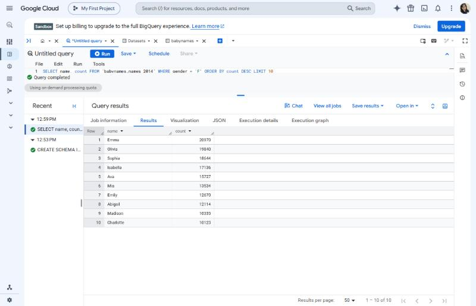
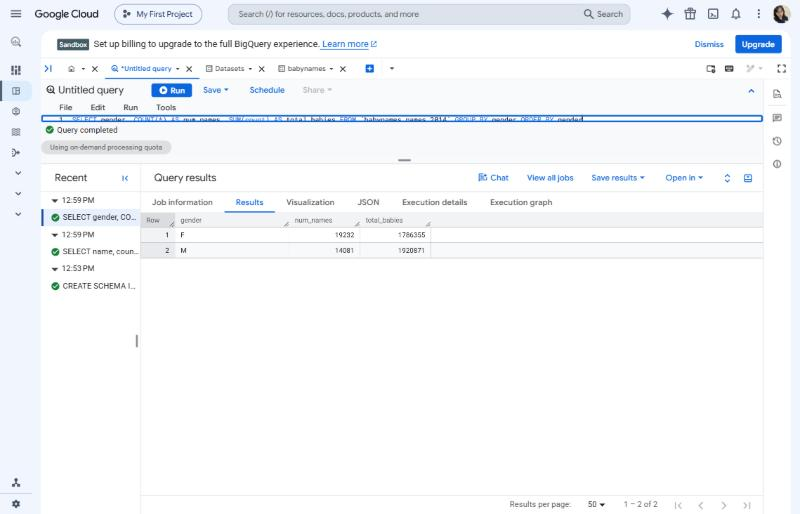
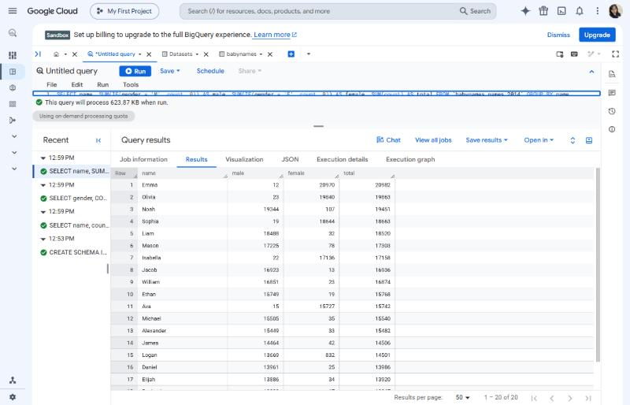
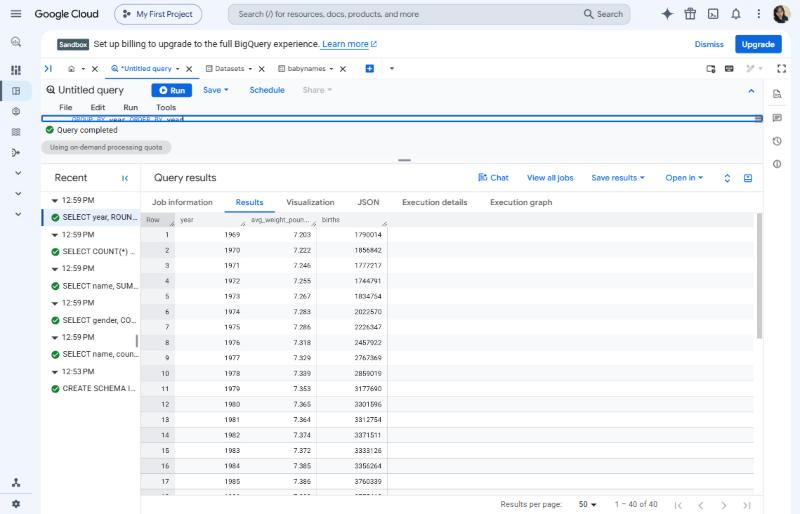
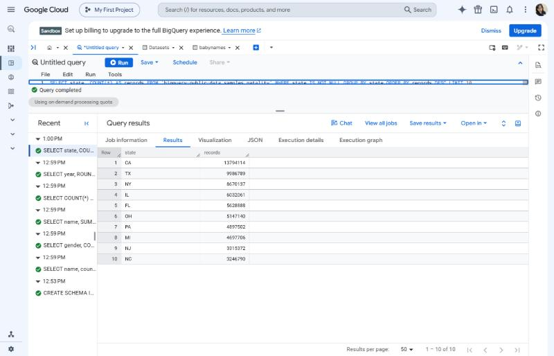
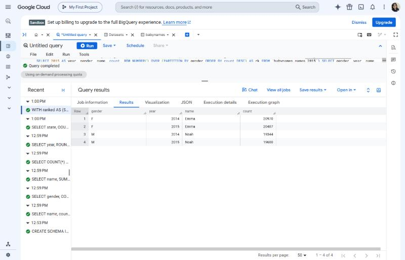

# Baby Names × Natality on BigQuery 👶📊

> การบ้าน **MyOrder Cloud Hero #13 · Day 1** — เขียน SQL ต่อยอดจาก Lab **GSP072 · BigQuery: Qwik Start – Console**
> ใช้ 2 ชุดข้อมูล: ตารางที่สร้างเอง `babynames.names_2014` และ public dataset `bigquery-public-data.samples.natality`

## 1. ไฟล์ใน repo

| ไฟล์ | เนื้อหา |
|---|---|
| [`queries.sql`](queries.sql) | SQL ครบทุกข้อ (Q1–Q5 + โจทย์เสริม) มีคอมเมนต์เลขข้อ |
| [`analyze.py`](analyze.py) | รัน query ผ่าน BigQuery Python client แล้วเขียนผลเป็น Markdown ลง `results/` |
| `results/` | ผลลัพธ์ Markdown ที่ `analyze.py` สร้าง (ไม่ได้ commit) |
| [`screenshots/`](screenshots/) | ภาพหน้าจอผลลัพธ์จาก BigQuery Console (โปรเจกต์ sandbox) |
| `.env.example` | ตัวอย่างตั้งค่า Project ID (ไฟล์ `.env` จริงไม่ถูก commit) |

## 2. เตรียมข้อมูล

1. ดาวน์โหลด `names.zip` จาก SSA (ลิงก์ใน Lab) แตกไฟล์ได้ `yob2014.txt`, `yob2015.txt`
2. BigQuery Console → สร้าง dataset `babynames`
3. Create table → Upload `yob2014.txt` (CSV) → ชื่อตาราง `names_2014`, schema: `name:string, gender:string, count:integer`
4. (โจทย์เสริม) ทำซ้ำกับ `yob2015.txt` → ตาราง `names_2015`

## 3. วิธีรัน `analyze.py`

```powershell
pip install -r requirements.txt
gcloud auth application-default login
copy .env.example .env      # แก้ GOOGLE_CLOUD_PROJECT เป็น Project ID ของตัวเอง
python analyze.py           # รันทุกข้อ
python analyze.py Q1 Q4     # รันเฉพาะบางข้อ
```

## 4. คำตอบแต่ละข้อ

### Q1 — ชื่อผู้หญิงยอดนิยม 10 อันดับแรก (2014)

```sql
SELECT name, count FROM `babynames.names_2014`
WHERE gender = 'F' ORDER BY count DESC LIMIT 10;
```



| # | name | count |
|---|---|---|
| 1 | Emma | 20,970 |
| 2 | Olivia | 19,840 |
| 3 | Sophia | 18,644 |
| 4 | Isabella | 17,136 |
| 5 | Ava | 15,727 |
| 6 | Mia | 13,534 |
| 7 | Emily | 12,670 |
| 8 | Abigail | 12,114 |
| 9 | Madison | 10,333 |
| 10 | Charlotte | 10,123 |

**ผล:** Emma อันดับ 1 (20,970 คน) ตามด้วย Olivia และ Sophia

**อธิบาย:** กรองเฉพาะ `gender = 'F'` แล้วเรียง `count` จากมากไปน้อย เอา 10 แถวแรก

### Q2 — แต่ละเพศมีกี่ชื่อ และยอดรวมเท่าไร

```sql
SELECT gender, COUNT(*) AS num_names, SUM(count) AS total_babies
FROM `babynames.names_2014` GROUP BY gender;
```



| gender | num_names | total_babies |
|---|---|---|
| F | 19,232 | 1,786,355 |
| M | 14,081 | 1,920,871 |

**ผล:** ชื่อผู้หญิงมีความหลากหลายกว่า (19,232 ชื่อ vs 14,081) แต่จำนวนเด็กชายรวมมากกว่า (1,920,871 vs 1,786,355)

**อธิบาย:** `COUNT(*)` = จำนวนชื่อ (1 แถว = 1 ชื่อต่อเพศ), `SUM(count)` = จำนวนเด็กทั้งหมด ข้อสังเกต: ข้อมูล SSA ตัดชื่อที่มีเด็กน้อยกว่า 5 คนออก ยอดรวมจึงต่ำกว่าจำนวนเด็กเกิดจริงเล็กน้อย

### Q3 — ชื่อ unisex (มีทั้ง M และ F)

```sql
SELECT name,
       SUM(IF(gender='M', count, 0)) AS male,
       SUM(IF(gender='F', count, 0)) AS female,
       SUM(count) AS total
FROM `babynames.names_2014`
GROUP BY name
HAVING COUNT(DISTINCT gender) = 2
ORDER BY total DESC LIMIT 20;
```



| # | name | male | female | total |
|---|---|---|---|---|
| 1 | Emma | 12 | 20,970 | 20,982 |
| 2 | Olivia | 23 | 19,840 | 19,863 |
| 3 | Noah | 19,344 | 107 | 19,451 |
| 4 | Sophia | 19 | 18,644 | 18,663 |
| 5 | Liam | 18,488 | 32 | 18,520 |
| 6 | Mason | 17,225 | 78 | 17,303 |
| 7 | Isabella | 22 | 17,136 | 17,158 |
| 8 | Jacob | 16,923 | 13 | 16,936 |
| 9 | William | 16,851 | 23 | 16,874 |
| 10 | Ethan | 15,749 | 19 | 15,768 |
| 11 | Ava | 15 | 15,727 | 15,742 |
| 12 | Michael | 15,505 | 35 | 15,540 |
| 13 | Alexander | 15,449 | 33 | 15,482 |
| 14 | James | 14,464 | 42 | 14,506 |
| 15 | Logan | 13,669 | 832 | 14,501 |
| 16 | Daniel | 13,961 | 25 | 13,986 |
| 17 | Elijah | 13,886 | 34 | 13,920 |
| 18 | Benjamin | 13,830 | 17 | 13,847 |
| 19 | Jayden | 12,995 | 580 | 13,575 |
| 20 | Mia | 13 | 13,534 | 13,547 |

**ผล:** มีชื่อ unisex ทั้งหมด **2,502 ชื่อ** ([screenshot](screenshots/Q3b.jpg)) — แต่อันดับต้น ๆ ส่วนใหญ่เป็นชื่อที่ “เอียงเพศเดียว” เช่น Emma มีผู้ชายแค่ 12 คน ชื่อที่ใช้สองเพศจริง ๆ ในลิสต์นี้คือ Logan (หญิง 832) และ Jayden (หญิง 580)

**อธิบาย:** `GROUP BY name` แล้วใช้ `HAVING COUNT(DISTINCT gender) = 2` เก็บเฉพาะชื่อที่มีทั้งสองเพศ ใช้ `SUM(IF(...))` pivot ให้เห็นยอดชาย/หญิงในแถวเดียว (ทำแบบ self-join ก็ได้ แต่ต้องอ่านตารางสองรอบ)

### Q4 — น้ำหนักแรกเกิดเฉลี่ยแยกตามปี (natality)

```sql
SELECT year, ROUND(AVG(weight_pounds), 3) AS avg_weight_pounds, COUNT(*) AS births
FROM `bigquery-public-data.samples.natality`
WHERE weight_pounds IS NOT NULL
GROUP BY year ORDER BY year;
```



<details><summary>ตารางผลลัพธ์ (40 ปี)</summary>

| year | avg_weight_pounds | births |
|---|---|---|
| 1969 | 7.203 | 1,790,014 |
| 1970 | 7.222 | 1,856,842 |
| 1971 | 7.246 | 1,777,217 |
| 1972 | 7.255 | 1,744,791 |
| 1973 | 7.267 | 1,834,754 |
| 1974 | 7.283 | 2,022,570 |
| 1975 | 7.286 | 2,226,347 |
| 1976 | 7.318 | 2,457,922 |
| 1977 | 7.329 | 2,767,369 |
| 1978 | 7.339 | 2,859,019 |
| 1979 | 7.353 | 3,177,690 |
| 1980 | 7.365 | 3,301,596 |
| 1981 | 7.364 | 3,312,754 |
| 1982 | 7.374 | 3,371,511 |
| 1983 | 7.372 | 3,333,126 |
| 1984 | 7.385 | 3,356,264 |
| 1985 | 7.386 | 3,760,339 |
| 1986 | 7.382 | 3,755,413 |
| 1987 | 7.376 | 3,808,357 |
| 1988 | 7.376 | 3,909,554 |
| 1989 | 7.367 | 4,040,445 |
| 1990 | 7.369 | 4,157,591 |
| 1991 | 7.353 | 4,110,576 |
| 1992 | 7.361 | 4,064,922 |
| 1993 | 7.344 | 3,999,716 |
| 1994 | 7.341 | 3,952,340 |
| 1995 | 7.335 | 3,898,933 |
| 1996 | 7.331 | 3,890,044 |
| 1997 | 7.319 | 3,880,291 |
| 1998 | 7.317 | 3,940,552 |
| 1999 | 7.311 | 3,958,646 |
| 2000 | 7.312 | 4,058,963 |
| 2001 | 7.289 | 4,028,346 |
| 2002 | 7.272 | 4,024,378 |
| 2003 | 7.256 | 4,092,479 |
| 2004 | 7.235 | 4,115,074 |
| 2005 | 7.214 | 4,141,625 |
| 2006 | 7.197 | 4,268,495 |
| 2007 | 7.193 | 4,319,414 |
| 2008 | 7.192 | 4,250,791 |

</details>

**ผล:** น้ำหนักเฉลี่ยเพิ่มจาก 7.203 lb (1969) ขึ้นสูงสุด 7.386 lb (1985) แล้วค่อย ๆ ลดลงเหลือ 7.192 lb (2008)

**อธิบาย:** `AVG()` ข้าม NULL อยู่แล้ว แต่ใส่ `WHERE weight_pounds IS NOT NULL` เพื่อให้ `births` นับเฉพาะแถวที่มีน้ำหนักจริง BigQuery เป็น columnar จึงสแกนแค่ 2 คอลัมน์ (`year`, `weight_pounds`) ไม่ใช่ทั้งตาราง

### Q5 — 10 รัฐที่มีจำนวนบันทึกมากที่สุด (natality)

```sql
SELECT state, COUNT(*) AS records
FROM `bigquery-public-data.samples.natality`
WHERE state IS NOT NULL
GROUP BY state ORDER BY records DESC LIMIT 10;
```



| # | state | records |
|---|---|---|
| 1 | CA | 13,794,114 |
| 2 | TX | 9,986,789 |
| 3 | NY | 8,670,137 |
| 4 | IL | 6,032,061 |
| 5 | FL | 5,628,888 |
| 6 | OH | 5,147,140 |
| 7 | PA | 4,897,502 |
| 8 | MI | 4,697,706 |
| 9 | NJ | 3,315,372 |
| 10 | NC | 3,246,790 |

**ผล:** California มีบันทึกมากที่สุด (13.8 ล้าน) ตามด้วย Texas และ New York

**อธิบาย:** ต้องกรอง `state IS NOT NULL` เพราะปีหลัง ๆ ของ dataset ไม่มีข้อมูลรัฐ ถ้าไม่กรอง NULL จะขึ้นเป็นอันดับ 1

### โจทย์เสริม — ชื่ออันดับ 1 ปี 2014 vs 2015

```sql
WITH ranked AS (
  SELECT 2014 AS year, gender, name, count,
         ROW_NUMBER() OVER (PARTITION BY gender ORDER BY count DESC) AS rk
  FROM `babynames.names_2014`
  UNION ALL
  SELECT 2015, gender, name, count,
         ROW_NUMBER() OVER (PARTITION BY gender ORDER BY count DESC)
  FROM `babynames.names_2015`
)
SELECT gender, year, name, count FROM ranked WHERE rk = 1 ORDER BY gender, year;
```



| gender | year | name | count |
|---|---|---|---|
| F | 2014 | Emma | 20,970 |
| F | 2015 | Emma | 20,487 |
| M | 2014 | Noah | 19,344 |
| M | 2015 | Noah | 19,680 |

**ผล:** อันดับ 1 ไม่เปลี่ยน — Emma (หญิง) ยอดลดลง 483 คน, Noah (ชาย) ยอดเพิ่มขึ้น 336 คน

**อธิบาย:** ใช้ window function `ROW_NUMBER()` แบ่งตามเพศในแต่ละปี แล้ว `UNION ALL` สองปีเข้าด้วยกัน เลือกเฉพาะ `rk = 1`

## 5. ส่วนที่ใช้ AI ช่วย

- ใช้ **Claude Code** ช่วยร่าง `queries.sql`, `analyze.py` และโครง README
- รันทุก query ใน BigQuery Console จริง (screenshot ในแต่ละข้อ) และเทียบผลข้อ babynames กับไฟล์ `yob2014.txt`/`yob2015.txt` ด้วย Python แล้วตรงกันทุกตัว
- ตัดสินใจเอง: เลือกใช้ `SUM(IF())` แทน self-join ในข้อ 3, ใส่ `WHERE ... IS NOT NULL` ในข้อ 4–5

## 6. อ้างอิง

- Lab GSP072 — BigQuery: Qwik Start – Console
- [BigQuery Python client](https://cloud.google.com/python/docs/reference/bigquery/latest)
- [SSA Baby Names data](https://www.ssa.gov/oact/babynames/limits.html)
